<!-- 
  ==============================================================
  🌸 SherlockYzz (折木柯南) · GitHub Profile
  河南大学软件学院 · 探寻算法逻辑与二次元交互美学的交汇处
  ==============================================================
-->

  

  
  
  
  
  

---

### 🌸 见字如晤 (About Me)

你好，我是 **SherlockYzz（折木柯南）**，现就读于 **河南大学(HENU)软件学院**。

一名正在探索代码、前沿技术以及数字创作的学生开发者。热衷于将严谨的底层代码逻辑与天马行空的视听交互融为一体：

* 🎮 **多模态与创意交互**：持续探索 **AI 漫剧全流程管线**（角色一致性、动态分镜与视听合成）、**多模态软件开发**（融合视觉与语音感知），以及 **独立游戏制作与人机交互 (HCI)**；
* 📐 **算法与科研探索**：当前重点关注**跨模态与多模态技术（视觉-语言理解、多模态交互生成）**；与此同时，沉下心来系统研读机器学习（ML）与深度学习（DL）的核心数学基石与经典理论，踏实打牢底座；
* 💻 **工程架构与根基**：以 C/C++ 筑牢数据结构与算法功底，日常使用 JavaScript / TypeScript 构筑现代应用与 WebGL 交互，辅以 Python 进行数据处理与多模态智能体实验。

---

### 🏆 权威收录与开源荣誉 (Honors & Indexing)

* 🌐 **入选全球 AI 原生代码语料库 (XERJ Corpus Hub)**：  
  主导研发的宋代古瓷三维数字化研学项目《天青泥火》中，**“3D双器同台对比台、100x物理景深显微镜、AI多光谱应力热力场”**纯前端核心实现获评全球高质量开源范本，已被开源 AI 搜索引擎 **[XERJ](https://github.com/xerj-org/xerj)** 官方正式索引收录：  
  👉 **[SherlockYzz Contributor Profile @ XERJ Corpus Hub](https://hub.xerj.org/contributors/SherlockYzz)**  
  *(作为全球开发者与 Coding Agent 解决同类复杂 WebGL 渲染、微距景深着色器与文博数字化交互难题的标杆参考实现 Worked Reference)*

---

### 🌸 核心项目实践录 (Selected Works & Demos)

<table>
  <tr>
    <td width="50%" align="center">
      <b>🐾 <a href="https://github.com/SherlockYzz/cyber-hajimi-bili">Cyber-Gemini Twins (赛博双子星)</a></b> 
      B站全能多模态 AI 伴生代理 · WBI 动态签名 · 直播/专栏/动态全域巡航  
      
      
      
      
    </td>
    <td width="50%" align="center">
      <b>🏺 <a href="https://github.com/SherlockYzz/Memories-of-Chinese-Porcelain-Web">天青泥火 (Sky-Cyan & Kiln Fire v7.0)</a></b> 
      3D WebGL 沉浸空间 · 双器同台对比 · 100x 显微景深 · XERJ 官方收录  
      
      
      
      
    </td>
  </tr>
  <tr>
    <td width="50%" align="center">
      <b>🦊 <a href="https://github.com/SherlockYzz/anime-desktop-pet">AI 二次元桌宠 (Desktop Pet v08.00)</a></b> 
      九大角色全阵容 · 像素级透明穿透 · 10款 H5 微游戏套件 · 133段广播 CV  
      
      
      
      
    </td>
    <td width="50%" align="center">
      <b>🏮 <a href="https://github.com/SherlockYzz/mid-autumn-celebration">华夏岁时盛典 (Festival Suite)</a></b> 
      东方像素风 · C++17 控制台超分渲染 · HTML5 动力学粒子群交互  
      
      
      
    </td>
  </tr>
</table>

---

### 📖 拓展实践与开源生态 (More Practices)

* 🏯 **开封府智慧景区微信小程序** [团队协作 · 数字化服务系统 🔒]  
  参与官方智慧服务系统研发：设计手绘智慧地图分类标注体系与最短游览路径规划；实现全天节目演出时间轴倒计时；对接 Dify 智能体工作流提供全天候咨询，并参与互动式剧情推理「开封府断案」模块研发。
* 📚 [**校园开源学习资料知识库 (HENU Review Kit)**](https://github.com/SherlockYzz/HENU-Final-Review)  
  与同学携手共建的校园开源知识库，系统化整理 C/C++、Web 编程、数据结构及高等数学期末备考思维导图与核心题型解析。
* 📐 [**常微分方程（ODE）知识梳理与题型总结**](https://github.com/SherlockYzz/Self-summary-of-Differential-Equations)  
  高等数学与考研常微分方程方法笔记，附带离线 MathJax 高清公式体系。

---

### 📊 动态与数据足迹 (GitHub Activity)

  
  

---

  <i>🌌「我们生而眺望，自星海尽处回响！」🌌</i> 
  <b>「这一切都是命运石之门的选择。El Psy Congroo！」</b>

